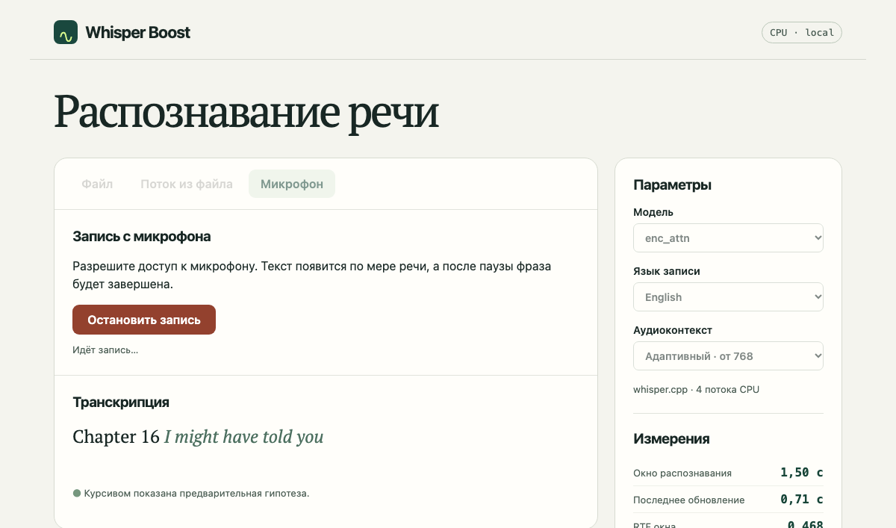

# Демо потокового распознавания

После [подготовки CPU-сборки](../README.md#для-команды) запустите из корня проекта и откройте [локальную страницу](http://127.0.0.1:8765).

```sh
uv run scripts/export_model.py policies/m3_enc1.json .work/models/m3_enc1.bin
uv run python -m demo.server --threads 4 --resident-model m3_enc1
```

- **Файл** — выберите свою запись или пример Golos / LibriSpeech и нажмите «Распознать».
- **Поток из файла** — нажмите «Воспроизвести потоком». Запись звучит с обычной скоростью, текст появляется во время речи.
- **Микрофон** — разрешите доступ и начните говорить. Курсив показывает слова, которые ещё могут измениться.

У потока из файла и микрофона есть настройка **«Обновление текста»**. Режим «Подтверждать совпавшие слова» закрепляет начало фразы, когда оно совпало в двух соседних версиях. Режим «Готовить финал во время паузы» начинает распознавать после первой секунды звука во фразе или короткой паузы. После 200 мс тишины он готовит возможное окончание фразы. Если речь продолжается, демо уточняет текст. Если пауза длится 800 мс или пользователь нажал «Остановить», готовый результат можно сразу показать. До завершения фразы её текст остаётся предварительным.

Сервер держит веса в памяти. Каждое окно распознаётся в новом состоянии. Для сравнения можно запустить сервер без `--resident-model`, тогда он вызывает CLI и загружает веса на каждое окно. Время до первого текста отсчитывается от начала подачи звука.



[Первый этап — загрузка модели](../results/m3-small/stream.csv) · [Сравнение потока и обработки целой записи](../results/REPORT.md#сколько-ждать-финальный-текст) · [Повторить замеры](../docs/reproduce.md#три-карты-и-стриминг)
