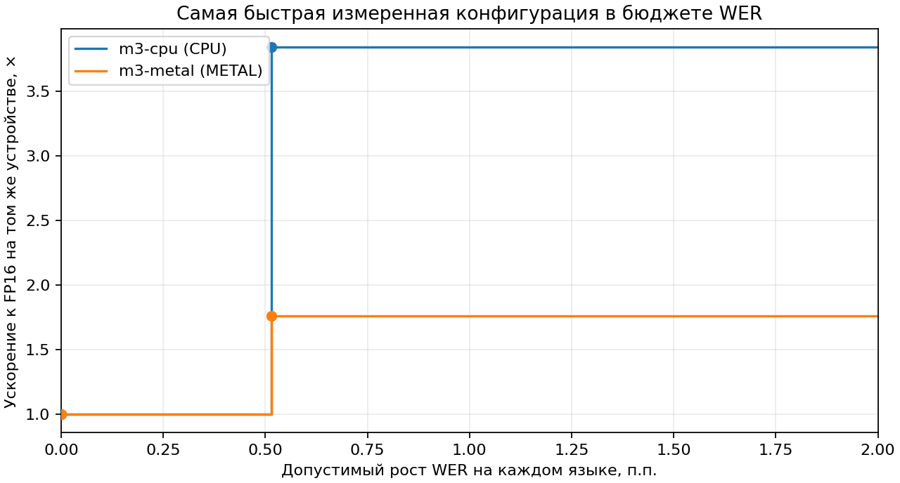

# Подбор весов и окна под устройство

**На Apple M3 Pro при допуске +1 п.п. WER и CPU, и Metal GPU выбрали равномерную Q4 с адаптивным окном от 768 позиций.** На отложенном тесте эта конфигурация ускорила обработку в **4,07× на CPU** и **1,80× на GPU** относительно FP16 с полным окном на том же устройстве.

Сравнили шесть сочетаний. Для каждого из трёх вариантов весов (FP16, Q4, смешанная `m3_enc1`) измерили полное и адаптивное окно. На восьми записях каждого языка выбрали самую быструю конфигурацию, которая укладывается в допуск WER отдельно для RU и EN. При допуске 0 или 0,5 п.п. осталась исходная FP16. При допуске 1 или 2 п.п. прошла Q4. Границу определила одна дополнительная ошибка на 194 английских словах.

## Проверка на 24 русских и 24 английских записях

| Устройство и модель | WER RU | RTF RU | WER EN | RTF EN | Ускорение по всему аудио |
|---|---:|---:|---:|---:|---:|
| CPU, FP16 | 43,64% | 0,9389 | 2,97% | 0,3791 | 1,00× |
| CPU, Q4 с адаптивным окном | 41,82% | 0,2224 | 3,42% | 0,0966 | **4,07×** |
| Metal GPU, FP16 | 41,82% | 0,1574 | 2,97% | 0,0697 | 1,00× |
| Metal GPU, Q4 с адаптивным окном | 40,91% | 0,0881 | 3,42% | 0,0386 | **1,80×** |

RTF показывает время обработки секунды аудио. Замер включал загрузку модели на каждый файл, один проход после прогрева и четыре потока. CPU и GPU различались по скорости и по русскому WER даже у исходной FP16. Поэтому каждый бэкенд сравнивали со своим эталоном. Результаты для CUDA предстоит измерить отдельно. [Измерения CPU](m3-cpu/confirmation-test.json) · [Измерения Metal](m3-metal/confirmation-test.json) · [Запуск на своём устройстве или в Colab](../../docs/target-tuning.md)
